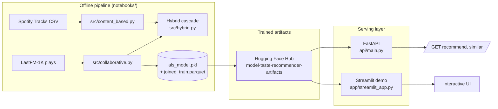

# Music Taste Recommender

A hybrid (content-based + collaborative filtering) music recommender, evaluated against
13.4 million real listening events — built as a case study in recommender
systems and honest data storytelling.

**The question:** can audio features alone tell you what a listener wants, or do you
need to know what people actually did?

📊 **[Read the presentation](reports/presentation.html)** — plain-language walkthrough with charts, built for a non-technical audience
📄 **[Read the technical case study](reports/case_study.md)** — full methodology, every number sourced to a notebook cell
🚀 **[Try the live demo](https://music-taste-recommender-lryc4l3hnfqbmjwfqhmnne.streamlit.app/)** — pick a genre, type a song or artist, see real audio-feature-similar tracks

## Architecture



The offline pipeline (training, evaluation, the full case study) is what `notebooks/`
does. The serving layer is separate and lightweight: both the API and the demo app load
the same trained artifacts and reuse the same `src/` recommendation logic — no modeling
code is duplicated for serving. Artifacts live on Hugging Face Hub rather than in git
because the fitted ALS model is 222MB, over GitHub's file-size limit; both `api/` and
`app/` download and cache them on first run if not already present locally.

## Results

Both approaches were built in full and evaluated with a temporal per-user split (train
on each listener's earlier plays, test on their most recent ones) against 792 held-out
users and the full 657,551-item catalog:

| Method | Precision@10 | Recall@10 | Catalog coverage | Diversity |
|---|---|---|---|---|
| Popularity baseline | **0.0965** | 0.0011 | ~0% | 1.01 |
| Content-based only | 0.0023 | ~0.0000 | 0.93% | 0.08 |
| Collaborative (ALS) | 0.0880 | **0.0013** | 0.52% | 0.61 |
| Hybrid | 0.0880 | **0.0013** | 0.52% | 0.61 |

**Headline findings:**
- Personalization (ALS) finds **19% more of what listeners actually go on to enjoy**
  than a trivial popularity baseline, while covering far more of the catalog — the
  classic precision-vs-breadth tradeoff, confirmed empirically rather than assumed.
- Matching songs to a listener's history only works for **1.29% of unique tracks**
  played, because the two source datasets barely overlap. That's reported as a real
  data-integration finding, not hidden — see the case study for how it was verified.
- Tempo and loudness turned out to separate music genres far more than danceability or
  mood, contradicting the initial hypothesis — see "What surprised us" in the case study.
- The hybrid ties pure collaborative filtering on this evaluation slice, and the writeup
  explains exactly why (the held-out population excludes the cold-start users the hybrid
  is designed for) — a limitation stated plainly, not glossed over.

## Business relevance

Precision@10 and recall@10 are useful for comparing methods, but they aren't the metric
a music product actually cares about. The real tradeoff this project surfaces:
recommending only what's already popular gets a marginally higher raw hit rate, but
personalization (ALS) surfaces 19% more of what a listener actually goes on to enjoy
while spreading recommendations across far more of the catalog. In product terms,
that's the difference between a service that keeps showing everyone the same hits (weak
long-term engagement, unused catalog) and one that helps people discover more of what
they'd actually like (the thing that drives retention). The honestly-reported cold-start
limitation — the hybrid's fallback path never triggers on this evaluation slice — is the
same story: it's not a flaw to hide, it's the exact reason a real product needs a
cold-start-specific evaluation before shipping personalization to new users.

## Scalability considerations

This is a portfolio-scale demo (1K users, 740K catalog items), not a production system,
but the design choices below are the ones that would actually matter at scale:

- **Collaborative recommendations are O(1) per request** — ALS lookup is a single matrix
  row fetch, not a search. This scales to millions of users without a redesign.
- **Content-based similarity is precomputed at startup**, not per-request — the
  standardized feature matrix and cosine-similarity lookup are held in memory once. At a
  much larger catalog (tens of millions of tracks) brute-force cosine similarity stops
  being viable; the natural next step is an approximate nearest-neighbor index (e.g.
  FAISS or ScaNN) traded against a small accuracy loss for sublinear lookup time.
- **The FastAPI service is stateless** after startup load, so it scales horizontally —
  multiple replicas behind a load balancer, no shared mutable state between requests.
- **Caching** would be the first real optimization at scale: popular users'/tracks'
  recommendations are natural candidates for a TTL cache (e.g. Redis) rather than
  recomputing on every request.

## Monitoring (stated plan, not built)

A production version of this service would track: **request latency** (p50/p95 per
endpoint), **recommendation engagement** as an outcome proxy (click-through on
recommended tracks, since precision@10 against historical data doesn't tell you whether
new recommendations actually land), and **popularity-distribution drift** — if the
catalog's engagement patterns shift meaningfully from what the model was trained on,
that's a signal the ALS model needs retraining, not just a data quality issue. None of
this is built out here — a demo doesn't have production traffic to monitor — but it's
what "done" would actually mean beyond this repo.

## Data

- **Spotify Tracks Dataset** (114k tracks, audio features + genre + popularity) — item
  metadata for the content-based layer. `data/raw/spotify_tracks/dataset.csv`
- **LastFM-1K** (13.4M track-level listening events, ~1K users, timestamped) — implicit
  feedback for the collaborative filtering layer. Downloaded via HuggingFace
  (`matthewfranglen/lastfm-1k`), not committed (see `.gitignore`) — regenerated by
  running `notebooks/01_data_audit.ipynb`.
- Spotify's Million Playlist Dataset was the original plan for the collaborative layer
  but is no longer publicly downloadable (Spotify pulled it from AIcrowd; access now
  requires contacting Spotify Research directly) — LastFM-1K substituted instead, same
  track-level granularity.

## Structure
```
notebooks/
  01_data_audit.ipynb       # join coverage, data quality findings
  02_content_based.ipynb    # similarity model + taste map
  03_collaborative.ipynb    # ALS model + evaluation
  04_hybrid_and_eval.ipynb  # combination + baseline comparison table
src/                        # shared loading/eval/serving code, imported by notebooks, api/, and app/
api/                        # FastAPI serving layer
  main.py
  schemas.py
app/
  streamlit_app.py          # interactive demo (Streamlit Community Cloud)
scripts/
  train_als_with_mlflow.py  # MLflow-tracked rerun of notebook 03's training
reports/
  presentation.html         # business-facing walkthrough with charts
  case_study.md             # full technical writeup
  figures/                  # every chart, exported from the notebooks
Dockerfile                  # containerizes api/
CHECKLIST.md                 # portfolio-readiness checklist for this project
```

## Setup
```
python -m venv .venv
.venv\Scripts\activate
pip install -r requirements.txt
```

Run the notebooks in order (`01` through `04`) to reproduce everything from scratch;
each depends on outputs from the ones before it. See `reports/case_study.md` for the
full writeup and `reports/presentation.html` for the plain-language version.

## Running the API

```
uvicorn api.main:app --reload
```

Then open `http://localhost:8000/docs` for interactive OpenAPI docs. On first request,
`src/artifacts.py` downloads the trained model from Hugging Face Hub if it isn't already
present locally (from having run the notebooks) — no manual setup needed either way.

## Running the demo app

```
streamlit run app/streamlit_app.py
```

## Running with Docker

```
docker build -t music-recommender-api .
docker run -p 8000:8000 music-recommender-api
```

## Experiment tracking

```
python scripts/train_als_with_mlflow.py
mlflow ui
```

Reruns the exact training + evaluation from notebook 03, logged as a real MLflow run
(params, precision@10/recall@10, the fitted model as an artifact) — requires the raw
`lastfm_1k_train.parquet` locally (from running notebook 01), since it's reproducing
training, not serving.

## Deployment

The FastAPI service is verified locally and via Docker (see above); it isn't hosted
24/7, since the Streamlit demo is the recruiter-facing artifact that needs to actually
be live. The Streamlit app is deployed for free on
[Streamlit Community Cloud](https://streamlit.io/cloud) at
**[music-taste-recommender-lryc4l3hnfqbmjwfqhmnne.streamlit.app](https://music-taste-recommender-lryc4l3hnfqbmjwfqhmnne.streamlit.app/)**,
connected directly to this GitHub repo (`app/streamlit_app.py` as the entry point).
The live demo is intentionally scoped to one thing — pick a genre, then a song or
artist, and see audio-feature-similar tracks — rather than exposing both recommenders;
the full hybrid recommender (collaborative + content-based) is still available by
running the FastAPI service locally (see above) or the notebooks.

## License

MIT — see [LICENSE](LICENSE).
